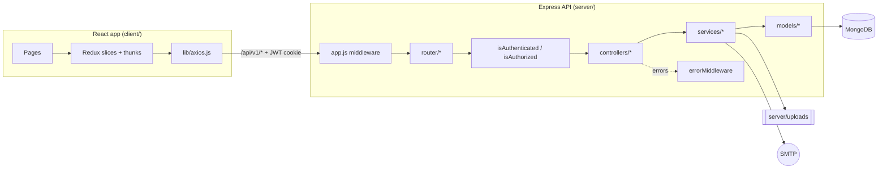

# FYP Management System

A full-stack (MERN) web application for managing **Final Year Projects** in a college department. Students submit proposals and upload deliverables, teachers supervise and give feedback, and admins manage users, approvals, supervisor assignments and deadlines.

## Features

| Role | What they can do |
|------|------------------|
| **Admin** | Create, edit and delete students and teachers · approve or reject proposals · assign supervisors (capacity-checked) · set project deadlines · dashboard with stats, a per-supervisor chart and an activity feed · download any project file |
| **Teacher** | See pending supervision requests and accept or reject them · view assigned students · give feedback (positive, general or negative) · mark projects as completed · browse and download students' files |
| **Student** | Submit a proposal (a new one is allowed after a rejection) · request a supervisor · upload the report, presentation and code (up to 10 files, 10 MB each) · read feedback · receive notifications |

In-app notifications are created for every important event. E-mails are sent for password resets and for request decisions.

## Tech stack

- **Frontend:** React 19, Vite 7, Redux Toolkit, React Router 7, Tailwind CSS 3, axios, react-toastify, recharts, lucide-react
- **Backend:** Node.js (20.19 or later), Express 5, Mongoose 9 (MongoDB), JSON Web Tokens in httpOnly cookies, bcrypt, multer, nodemailer, express-rate-limit

## Architecture



## Project structure

```
client/                 React frontend (Vite)
  src/App.jsx           routes + ProtectedRoute (role based)
  src/store/slices/     Redux slices (auth, admin, student, teacher, notification, ...)
  src/pages/            auth / student / teacher / admin pages
  src/components/       layout (Navbar, Sidebar) and modals
  src/lib/              axios instance, download helpers, constants
server/                 Express REST API
  server.js             entry: env check, DB connection, graceful shutdown
  app.js                middleware, routes, 404 and error handler
  config/               db connection, paths
  middlewares/          auth, errors, rate limits, uploads, project access
  controllers/          request handlers per role
  services/             business logic (users, projects, requests, files, e-mail, notifications)
  models/               Mongoose schemas
  router/               route definitions
  scripts/seedAdmin.js  creates the first Admin account
```

## Getting started

### 1. Prerequisites

- Node.js **20.19 or later** (required by Mongoose 9)
- MongoDB (local install or MongoDB Atlas)
- An SMTP account for e-mails (for example a Gmail App Password)

### 2. Backend

```bash
cd server
cp .env.example .env        # then edit the values
npm install
npm run seed:admin          # creates the first Admin from ADMIN_EMAIL / ADMIN_PASSWORD
npm run dev                 # http://localhost:4000
```

### 3. Frontend

```bash
cd client
cp .env.example .env        # VITE_API_URL=http://localhost:4000/api/v1
npm install
npm run dev                 # http://localhost:5173
```

Log in with the admin account, then create teachers and students from the admin dashboard.

### Environment variables (server)

| Variable | Required | Description |
|----------|----------|-------------|
| `MONGO_URI` | yes | MongoDB connection string |
| `JWT_SECRET` | yes | Long random string used to sign tokens |
| `PORT` | no | Defaults to 4000 |
| `DB_NAME` | no | Defaults to `projectManagementSystem` |
| `JWT_EXPIRE` / `COOKIE_EXPIRE` | no | Token lifetime (`7d`) and cookie lifetime in days (`7`) |
| `FRONTEND_URL` | yes in production | Allowed CORS origin(s), comma separated. The first one is used in e-mail links |
| `NODE_ENV` | yes in production | Set to `production` to get `Secure` + `SameSite=None` cookies and hide internal errors |
| `TRUST_PROXY` | behind a proxy | For example `1` on Render, Railway or Nginx |
| `SMTP_SERVICE` or `SMTP_HOST` + `SMTP_PORT`, `SMTP_MAIL`, `SMTP_PASSWORD`, `SMTP_FROM` | for e-mail | Mail settings |
| `ALLOW_PUBLIC_REGISTRATION` | no | `true` enables `POST /auth/register`, which creates Student accounts only |
| `API_RATE_LIMIT` / `AUTH_RATE_LIMIT` | no | Requests per 15 minutes per IP (defaults 1000 and 20) |
| `ADMIN_NAME` / `ADMIN_EMAIL` / `ADMIN_PASSWORD` | for `seed:admin` | First admin account |

## API overview (`/api/v1`)

| Area | Endpoints |
|------|-----------|
| Auth | `POST /auth/login` · `POST /auth/logout` · `GET /auth/me` · `POST /auth/Password/forgot` · `PUT /auth/Password/reset/:token` · `PUT /auth/Password/update` · `POST /auth/register` (optional) |
| Admin | `POST /admin/create-student` · `PUT /admin/update-student/:id` · `DELETE /admin/delete-student/:id` · the same three for `-teacher` · `GET /admin/users` · `GET /admin/projects` · `GET/PUT /admin/project/:id` · `POST /admin/assign-supervisor` · `GET /admin/fetch-dashboard-stats` |
| Student | `GET /student/project` · `POST /student/project-proposal` · `POST /student/upload/:projectId` · `GET /student/fetch-supervisors` · `GET /student/supervisor` · `POST /student/request-supervisor` · `GET /student/feedback/:projectId` · `GET /student/fetch-dashboard-stats` · `GET /student/download/:projectId/:fileId` |
| Teacher | `GET /teacher/fetch-dashboard-stats` · `GET /teacher/requests` · `PUT /teacher/requests/:id/accept` · `PUT /teacher/requests/:id/reject` · `POST /teacher/feedback/:projectId` · `POST /teacher/mark-complete/:projectId` · `GET /teacher/assigned-students` · `GET /teacher/files` · `GET /teacher/download/:projectId/:fileId` |
| Shared | `GET /notification` · `PUT /notification/:id/read` · `PUT /notification/read-all` · `DELETE /notification/:id/delete` · `GET /project/:projectId/files/:fileId/download` · `POST /deadline/create-deadline/:id` · `GET /health` |

Every response has the shape `{ success, message, data }`; errors are `{ success: false, message }` with a matching HTTP status code.

## Production notes

- Serve both apps over HTTPS and set `NODE_ENV=production`, `FRONTEND_URL` and `TRUST_PROXY`.
- `server/uploads/` holds the uploaded files. Put it on a persistent disk or volume (ephemeral PaaS disks lose files on redeploy) and back it up together with the database.
- Use a strong `JWT_SECRET`. Changing it logs everyone out.
